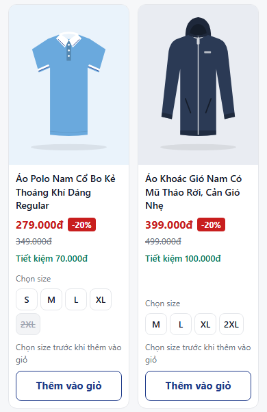
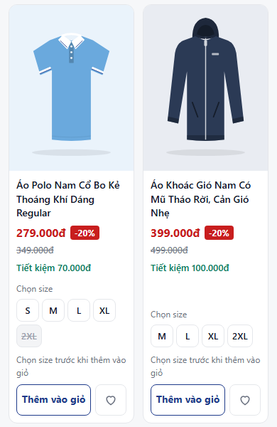
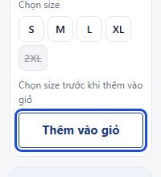
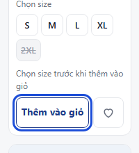

# Báo cáo Buổi 2 – HTML5 & CSS3 (bài tập cá nhân)

- **Sinh viên:** Nguyễn Thị Minh Nguyệt – 87251020135
- **Ngày thực hiện:** 31/10/2026
- **Khu vực chọn làm trọng tâm:** **Danh sách sản phẩm** (lưới 8 sản phẩm + thẻ sản phẩm) trong `index.html`. Đây là khu vực đã làm ở Buổi 1, Buổi 2 tiếp tục hoàn thiện.
- **Cách kiểm tra:** mở trang bằng Chrome, xem ở các chiều rộng 1366 px, 768 px, 390 px và thêm 360 px, 375 px (điện thoại Android phổ biến và iPhone SE). Ảnh chụp nằm trong thư mục [`screenshots/`](screenshots/).

---

## Bước 1. Rà soát bài Buổi 1 và xác định vấn đề

**Thành phần đã có:** header (logo, giỏ hàng), tiêu đề trang `h1`, lưới 8 sản phẩm (CSS Grid 2/3/4 cột), mỗi thẻ có ảnh, tên, giá khuyến mãi / giá gốc / % giảm, chọn size, nút "Thêm vào giỏ", footer.

**Ảnh trước khi chỉnh sửa:** [truoc-1366.png](screenshots/truoc-1366.png) · [truoc-768.png](screenshots/truoc-768.png) · [truoc-390.png](screenshots/truoc-390.png)

| # | Vấn đề | Hướng cải thiện | Kết quả mong muốn |
|---|---|---|---|
| 1 | 8 sản phẩm viết nối tiếp bằng `section` > `article`, không phải một danh sách. Tiêu đề `h1` nằm ngoài `section`, `section` chỉ có `aria-label` | Chuyển lưới thành `ul` > `li` > `article`; đưa tiêu đề vào `header` bên trong `section`, nối bằng `aria-labelledby` | Cấu trúc HTML đúng nghĩa: trình đọc màn hình báo "danh sách, 8 mục"; tiêu đề và danh sách thuộc cùng một khu vực |
| 2 | Hàng thao tác chỉ có 1 nút; chưa có chỗ cho nút "Yêu thích" (Buổi 3 sẽ gắn JavaScript) | Thêm hàng nút `.product-buy`, thực hành Flexbox: `display: flex`, `align-items`, `gap`, `flex` | Nút "Thêm vào giỏ" và nút tim nằm trên một hàng, thẳng hàng ở mọi thẻ |
| 3 | Nút "Thêm vào giỏ" đổi màu tức thì khi rê chuột. Quy tắc `prefers-reduced-motion` có nhắc tới `transition` của `.btn-add` nhưng `.btn-add` không hề có `transition` (mã thừa) | Thêm `transition` cho `.btn-add` và nút tim mới; thêm `:hover` cho nút tim | Chuyển màu mượt 0,2 giây; quy tắc giảm chuyển động có tác dụng thật |
| 4 | Khi nhấn **Tab** tới nút "Thêm vào giỏ", góc bo của nút đổi từ 8px thành 4px (quy tắc chung `a:focus-visible, button:focus-visible { border-radius: 4px }`) | Chỉ đặt `border-radius: 4px` cho `a:focus-visible` | Nút giữ nguyên hình dạng khi có viền focus |
| 5 | Liên kết tên sản phẩm, ảnh sản phẩm và giỏ hàng là `href="#"`: bấm vào thì trang nhảy lên đầu | Cần trang chi tiết sản phẩm và trang giỏ hàng, ngoài phạm vi Buổi 2 | **Chưa sửa**, ghi nhận để làm ở buổi sau |

---

## Bước 2. Cấu trúc HTML5 có ngữ nghĩa

**Thay đổi trong `index.html`:**

```html
<main class="container">
  <section class="product-list" aria-labelledby="product-list-title">
    <header class="page-head">
      <h1 class="page-title" id="product-list-title">Áo &amp; quần bán chạy</h1>
      <p class="page-count">8 sản phẩm</p>
    </header>

    <ul class="product-grid">
      <li>
        <article class="product-card"> … </article>
      </li>
      … (8 sản phẩm)
    </ul>
  </section>
</main>
```

Trong mỗi thẻ, nút "Thêm vào giỏ" được đặt vào hàng nút mới:

```html
<div class="product-buy">
  <button class="btn-add" type="button">Thêm vào giỏ</button>
  <button class="btn-fav" type="button" aria-label="Yêu thích" title="Yêu thích">
    <svg …>…</svg>   <!-- biểu tượng trái tim, aria-hidden -->
  </button>
</div>
```

**Giải thích các phần tử:**

| Phần tử | Lý do dùng |
|---|---|
| `section` + `aria-labelledby` | Khu vực "danh sách sản phẩm" là một phần có chủ đề riêng của trang. `aria-labelledby` lấy luôn chữ của `h1` làm tên khu vực, không phải viết thêm `aria-label` |
| `header` (trong `section`) | Phần đầu của khu vực: tiêu đề và số lượng sản phẩm |
| `ul` > `li` | Nội dung là **danh sách** 8 sản phẩm cùng loại. Trình đọc màn hình đọc được số mục |
| `article` | Mỗi sản phẩm là một khối nội dung độc lập (có ảnh, tên, giá, nút riêng), tách ra vẫn hiểu được |
| `h1` → `h2` | `h1` là tiêu đề trang, `h2` là tên từng sản phẩm. Thứ bậc không nhảy cóc |
| `img` + `alt` | Mô tả ảnh: màu sắc, kiểu dáng ("Áo polo nam màu xanh da trời, cổ bo kẻ trắng") |
| `button type="button"` + `aria-label` | Nút tim chỉ có biểu tượng nên cần `aria-label="Yêu thích"` để trình đọc màn hình đọc được. `type="button"` vì không nằm trong form gửi đi |

Các thẻ đóng mở cân bằng (đã đếm: `ul` 1/1, `li` 8/8, `article` 8/8, `div` 34/34, `button` 16/16, `a` 18/18).

**Câu hỏi tự kiểm tra:**

1. *Vì sao nên dùng `nav` cho khu vực điều hướng?* `nav` cho trình duyệt và trình đọc màn hình biết đây là nhóm liên kết điều hướng chính; người dùng trình đọc màn hình có thể nhảy thẳng tới đó. Trang của tôi hiện chưa có menu nên chưa dùng `nav` (không thêm phần tử chỉ để mã dài hơn).
2. *`article` khác `div` ở điểm nào?* `div` không mang nghĩa gì, chỉ để nhóm và định dạng. `article` nói rằng nội dung bên trong là một đơn vị độc lập (ở đây là một sản phẩm).
3. *Vì sao ảnh cần `alt`?* Xem Câu 6 bên dưới.
4. *Khi nào dùng `ul` và `li`?* Khi có nhiều mục cùng loại, thứ tự không quan trọng: danh sách sản phẩm, menu. Nếu thứ tự có ý nghĩa (các bước) thì dùng `ol`.

---

## Bước 3. Tệp CSS và liên kết

- CSS đã tách riêng từ Buổi 1: [`css/style.css`](css/style.css), liên kết trong `<head>` bằng `<link rel="stylesheet" href="css/style.css">`.
- **Cách kiểm tra đường dẫn:** mở DevTools (F12) → tab **Network** → tải lại trang (F5) → dòng `style.css` có trạng thái 200. Nếu sai đường dẫn sẽ thấy 404 (chữ đỏ) và trang hiện chữ đen trên nền trắng, không có lưới.
- **Kết quả:** CSS được áp dụng: `body` dùng font `system-ui…`, nền `#f6f7f9`; `.product-grid` có `display: grid`.
- Các quy tắc nền tảng đã có: `* { box-sizing: border-box }`, `body { margin: 0; font-family; color; background; line-height }`, `img { max-width: 100%; height: auto }`.

---

## Bước 4. CSS selector và Box Model

**Các loại selector đang dùng trong bài:**

| Loại | Ví dụ trong `style.css` | Tác dụng |
|---|---|---|
| Element selector | `body`, `img`, `a` | Định dạng chung cho mọi thẻ cùng loại |
| Class selector | `.product-card`, `.btn-add`, `.btn-fav` | Định dạng riêng cho thành phần có class đó |
| Descendant selector (con cháu) | `.product-card__media img`, `.btn-fav svg` | Chỉ chọn `img`/`svg` nằm bên trong phần tử cha đó |
| Child selector (con trực tiếp) | `.product-grid > li` *(Buổi 2)* | Chỉ chọn các `li` là con trực tiếp của lưới |
| Adjacent selector (kề cạnh) | `.size-picker input:checked + label` | Chọn `label` đứng ngay sau ô radio đang được chọn |
| Pseudo-class | `:hover`, `:focus-visible`, `:checked`, `:disabled`, `:has()` | Định dạng theo trạng thái |

**Box Model của thẻ sản phẩm (điện thoại 390 px):**

```
.product-card          border: 1px solid #e5e7eb; border-radius: 12px
└─ .product-card__body padding: 10px  (từ 600px: 12px)
   ├─ khoảng giữa các khối bên trong: gap: 6px
   └─ .product-buy     gap: 6px (từ 600px: 8px)
      ├─ .btn-add      padding: 0 6px (từ 600px: 0 12px); border: 1.5px; min-height: 44px
      └─ .btn-fav      44 × 44px; border: 1.5px; border-radius: 8px
Khoảng cách giữa các thẻ: gap của lưới (12px / 16px / 24px), không dùng margin
```

**Buổi 2 thêm cho danh sách `ul`:** trình duyệt mặc định cho `ul` có `margin`, `padding-left: 40px` và dấu chấm đầu dòng, nên phải đặt lại:

```css
.product-grid {
  margin: 0;
  padding: 0;
  list-style: none;
}

.product-grid > li {
  display: flex;      /* thẻ bên trong cao bằng ô lưới */
}

.product-card {
  flex: 1;            /* lấp đầy li */
  min-width: 0;
}
```

Nếu thiếu `padding: 0` thì lưới bị đẩy sang phải 40 px; nếu thiếu `display: flex` cho `li` thì các thẻ cùng hàng không còn cao bằng nhau (nút "Thêm vào giỏ" lệch nhau).

**Ảnh trước và sau (thẻ sản phẩm, 390 px):**

| Trước | Sau |
|---|---|
|  |  |

---

## Bước 5. Flexbox

**Khu vực thực hành:** hàng nút `.product-buy` (mới) trong mỗi thẻ sản phẩm.

```css
.product-buy {
  display: flex;                    /* đặt trên phần tử CHA */
  justify-content: space-between;
  align-items: center;
  gap: 6px;
}

.btn-add { flex: 1; }               /* giãn ra lấp chỗ trống */
.btn-fav { flex: 0 0 44px; }        /* không co, không giãn, luôn rộng 44px */
```

| Thuộc tính | Kết quả quan sát |
|---|---|
| `display: flex` | 2 nút nằm trên một hàng thay vì xếp chồng |
| `justify-content: space-between` | Trong hàng này **không thấy thay đổi**, vì `.btn-add` có `flex: 1` đã lấp hết chỗ trống, không còn khoảng trống để chia. Thử bỏ `flex: 1` thì nút tim bị đẩy sát phải, nút "Thêm vào giỏ" co lại vừa chữ |
| `align-items: center` | 2 nút căn giữa theo chiều dọc |
| `gap: 6px` | Khoảng cách giữa 2 nút, không cần đặt `margin` cho từng nút |

**Flexbox có sẵn từ Buổi 1 trong cùng khu vực:**

- `.page-head`: `justify-content: space-between` đẩy tiêu đề sang trái, "8 sản phẩm" sang phải; `align-items: baseline` cho hai dòng chữ cùng đường chân chữ.
- `.product-card`: `flex-direction: column`, kèm `margin-top: auto` ở `.product-card__actions`, đẩy phần mua hàng xuống đáy thẻ.
- `.price`: `flex-wrap: wrap` để giá khuyến mãi, % giảm, giá gốc tự xuống dòng khi thẻ hẹp.

**Câu hỏi tự kiểm tra:**

1. `display: flex` đặt trên **phần tử cha** (`.product-buy`). Các phần tử con (2 nút) trở thành flex item.
2. `justify-content: space-between`: phần tử đầu sát mép trái, phần tử cuối sát mép phải, khoảng trống chia đều ở giữa. Ví dụ ở `.page-head`.
3. `gap` chỉ tạo khoảng cách **giữa** các phần tử con, không thêm khoảng thừa ở mép ngoài. `margin` gắn vào từng phần tử nên phải đặt cho từng cái và dễ bị thừa ở phần tử cuối.

---

## Bước 6. CSS Grid cho danh sách sản phẩm

Lưới đã có từ Buổi 1; Buổi 2 đổi phần tử chứa từ `section` sang `ul` và đặt lại lề mặc định.

```css
.product-grid {
  display: grid;
  grid-template-columns: repeat(2, minmax(0, 1fr));  /* điện thoại: 2 cột */
  gap: var(--gap);
}
@media (min-width: 600px)  { .product-grid { grid-template-columns: repeat(3, minmax(0, 1fr)); } }
@media (min-width: 1024px) { .product-grid { grid-template-columns: repeat(4, minmax(0, 1fr)); } }

.product-card__media img {
  width: 100%;
  aspect-ratio: 3 / 4;
  object-fit: cover;       /* lấp đầy khung 3:4, cắt bớt phần thừa, không méo */
}
```

- `repeat(2, minmax(0, 1fr))` = 2 cột bằng nhau; `minmax(0, …)` cho phép cột co nhỏ hơn chữ dài, tránh tràn ngang.
- Kết quả đo: 2 cột (360–390 px), 3 cột (768 px), 4 cột (1366 px). Ảnh sau: [sau-1366.png](screenshots/sau-1366.png) · [sau-768.png](screenshots/sau-768.png) · [sau-390.png](screenshots/sau-390.png)

---

## Bước 7. Hiệu ứng hover và focus

```css
.btn-add {
  transition: background-color 0.2s ease, color 0.2s ease;   /* Buổi 2 */
}
.btn-add:hover { background: var(--color-primary-soft); }    /* có từ Buổi 1 */

.btn-fav {
  color: var(--color-muted);
  border: 1.5px solid var(--color-border);
  transition: color 0.2s ease, border-color 0.2s ease, background-color 0.2s ease;
}
.btn-fav:hover {                                               /* Buổi 2 */
  color: var(--color-sale);
  background: #fef2f2;
  border-color: var(--color-sale);
}

a:focus-visible,
button:focus-visible {
  outline: 3px solid var(--color-focus);
  outline-offset: 2px;
}
a:focus-visible { border-radius: 4px; }                        /* Buổi 2: tách riêng cho liên kết */
```

- **Hover** chỉ xảy ra khi rê chuột; trên điện thoại cảm ứng gần như không có. **Focus** xảy ra khi phần tử được chọn để thao tác (nhấn Tab). `:focus-visible` chỉ hiện viền khi dùng bàn phím, bấm chuột thì không hiện, nên không gây rối mắt.
- Khi người dùng bật "giảm chuyển động" trong hệ điều hành, `@media (prefers-reduced-motion: reduce)` tắt `transition` của `.product-card`, `.btn-add`, `.btn-fav`.

| Viền focus trước (góc nút bị đổi 4px) | Viền focus sau (nút giữ góc 8px) |
|---|---|
|  |  |

---

## Bước 8. Kiểm tra giao diện và tự sửa lỗi

### 8.1 Bảng kiểm thử

| Nội dung kiểm tra | Kết quả | Ghi chú |
|---|---|---|
| Trang HTML mở được | Đạt | Mở trực tiếp `index.html` và qua Live Preview |
| CSS được áp dụng | Đạt | `style.css` trạng thái 200 trong tab Network; font, màu nền, lưới hiển thị đúng |
| Hình ảnh hiển thị đúng | Đạt | 8/8 ảnh tải được, tỉ lệ 3:4, không méo ở cả 5 chiều rộng |
| Liên kết hoạt động | Đạt một phần | Logo → `index.html` hoạt động. Tên/ảnh sản phẩm và "Giỏ hàng" là `href="#"` vì chưa có trang chi tiết và trang giỏ hàng (vấn đề 5 ở Bước 1) |
| Bố cục không bị tràn nghiêm trọng | Đạt | Không có thanh cuộn ngang ở 360, 375, 390, 768, 1366 px |
| Hover/focus hoạt động | Đạt | Focus: Tab tới nút hiện viền xanh, nút giữ góc bo (ảnh `focus-sau.png`). Hover: rê chuột vào nút "Thêm vào giỏ" thấy nền xanh nhạt, nút tim chuyển đỏ |
| Đã tự sửa ít nhất một vấn đề | Đạt | Lỗi chữ "Thêm vào giỏ" xuống 2 dòng (mục 8.2) và lỗi góc bo khi focus (vấn đề 4) |

### 8.2 Vấn đề tự phát hiện: chữ "Thêm vào giỏ" bị xuống 2 dòng trên điện thoại

- **Hiện tượng:** sau khi thêm nút tim vào cạnh nút "Thêm vào giỏ", ở 390 px chữ bị tách thành "Thêm vào / giỏ", nút cao lên và lệch so với nút tim. Ảnh: [loi-nut-2-dong-390.png](screenshots/loi-nut-2-dong-390.png)
- **Nguyên nhân:** ở 390 px mỗi thẻ chỉ rộng khoảng 175 px, trừ padding còn khoảng 155 px. Nút tim chiếm 44 px, `gap` 8 px, nên nút "Thêm vào giỏ" chỉ còn khoảng 103 px, trong khi chữ cỡ 15 px cộng padding 2 × 12 px cần nhiều hơn thế.
- **Cách sửa (mobile-first):** trên điện thoại giảm `padding` của nút còn `0 6px`, cỡ chữ `0.875rem` (14 px), `gap` còn 6 px; từ 600 px trở lên trả lại `padding: 0 12px`, `font-size: 0.9375rem`, `gap: 8px` trong media query.
- **Kiểm tra lại:** lần kiểm tra đầu chỉ đo chiều cao nút (vẫn 44 px) nên tưởng đã hết lỗi. Nhưng 2 dòng chữ 14 px (line-height 1.5 = 42 px) vẫn lọt trong `min-height: 44px`, nên chiều cao không chứng minh được gì. Đếm số dòng chữ thực tế thì thấy:

  | Chiều rộng | Chiều rộng nút | Số dòng chữ |
  |---|---|---|
  | 360 px | 90 px | 2 |
  | 375 px | 98 px | 2 |
  | 390 px | 105 px | **1** |
  | 768 px | 154 px | 1 |
  | 1366 px | 192 px | 1 |

  Ở 360–375 px thẻ quá hẹp, không thể đặt vừa cả hai nút trên một dòng nếu không thu nhỏ chữ quá mức. Phương án chọn: cho phép xuống 2 dòng nhưng thêm `line-height: 1.2`, để 2 dòng nằm gọn trong nút 44 px, nút không cao lên và các thẻ vẫn đều nhau. Ảnh: [sau-360-nut-2-dong.png](screenshots/sau-360-nut-2-dong.png)

### 8.3 Lưu ý khi chụp ảnh bằng Chrome

Ảnh 390 px chụp lần đầu bị tràn ngang, mất một phần thẻ bên phải. Kiểm tra lại thì do Chrome chạy ở chế độ không giao diện có chiều rộng cửa sổ tối thiểu khoảng 500 px, trang thực tế vẫn hiển thị đúng. Ảnh đã được chụp lại trong khung đúng 390 px. Khi kiểm tra điện thoại nên dùng **chế độ giả lập thiết bị** của DevTools (Ctrl + Shift + M), không thu nhỏ cửa sổ.

---

## Câu hỏi kiểm tra kiến thức

**Câu 1. Trong khu vực giao diện của em, em đã sử dụng những phần tử HTML5 nào? Vì sao em chọn chúng?**

Trong khu vực danh sách sản phẩm tôi dùng: `section` (cả khu vực, nối với tiêu đề bằng `aria-labelledby`), `header` (phần đầu khu vực: `h1` và số sản phẩm), `ul`/`li` (vì đây là danh sách 8 sản phẩm cùng loại), `article` (mỗi sản phẩm là một khối độc lập), `h2` (tên sản phẩm, cấp dưới `h1`), `img` có `alt`, `del` (giá gốc đã bị thay bằng giá khuyến mãi), `fieldset` + `legend` + `input type="radio"` + `label` (nhóm chọn size, mỗi thẻ chỉ chọn được 1 size) và `button type="button"` (nút thao tác). Tôi chọn theo ý nghĩa của nội dung: dùng thẻ có nghĩa thay cho `div` để trình duyệt, trình đọc màn hình và công cụ tìm kiếm hiểu được cấu trúc trang.

**Câu 2. Giải thích sự khác nhau giữa margin và padding. Cho ví dụ từ thẻ sản phẩm của em.**

`padding` là khoảng cách **bên trong** viền, giữa viền và nội dung; nền của phần tử phủ cả phần padding. `margin` là khoảng cách **bên ngoài** viền, đẩy các phần tử khác ra xa; margin luôn trong suốt. Trong thẻ của tôi: `.product-card__body { padding: 10px }` giữ cho tên, giá, nút không dính sát viền thẻ (từ 600 px tăng lên 12 px). `.page-head { margin: 20px 0 12px }` tạo khoảng trống phía trên tiêu đề và giữa tiêu đề với lưới. Giữa các thẻ tôi không dùng margin mà dùng `gap` của Grid. Nhờ `box-sizing: border-box`, padding và border được tính vào chiều rộng của thẻ nên thẻ không phình ra khỏi cột.

**Câu 3. Trong bài của em, Flexbox được sử dụng ở đâu? Giải thích tác dụng của justify-content và align-items.**

Ở Buổi 2: hàng nút `.product-buy` (nút "Thêm vào giỏ" + nút tim). Từ Buổi 1: `.site-header__inner` (logo và giỏ hàng), `.page-head` (tiêu đề và số sản phẩm), `.price` (giá), `.product-card` (xếp dọc nội dung thẻ), `.size-picker__options` (các ô size). `justify-content` căn các phần tử theo **trục chính** (hàng ngang khi `flex-direction: row`): ở `.page-head`, `space-between` đẩy tiêu đề sang trái và "8 sản phẩm" sang phải. `align-items` căn theo **trục còn lại** (chiều dọc): ở `.product-buy`, `center` làm 2 nút cùng nằm giữa theo chiều cao; ở `.page-head`, `baseline` làm 2 dòng chữ to nhỏ khác nhau cùng đường chân chữ.

**Câu 4. CSS Grid khác Flexbox như thế nào? Vì sao em sử dụng Grid cho danh sách sản phẩm?**

Flexbox bố trí theo **một chiều** (một hàng hoặc một cột), kích thước phần tử phụ thuộc nội dung. Grid bố trí theo **hai chiều** cùng lúc (hàng và cột), cột được định nghĩa trước bằng `grid-template-columns`. Danh sách sản phẩm cần các thẻ thẳng hàng cả ngang lẫn dọc, cột rộng bằng nhau dù tên sản phẩm dài ngắn khác nhau, và đổi số cột theo màn hình (2/3/4) chỉ bằng một dòng CSS. Grid làm việc này gọn hơn. Bên trong từng thẻ hoặc một hàng nút thì chỉ có một chiều nên tôi dùng Flexbox.

**Câu 5. Nếu xóa quy tắc CSS display: grid khỏi danh sách sản phẩm, giao diện có thể thay đổi như thế nào?**

`ul.product-grid` trở về dạng khối bình thường, `grid-template-columns` và `gap` không còn tác dụng (kể cả trong media query). Mỗi `li` chiếm hết chiều ngang nên 8 thẻ xếp chồng dọc, mỗi hàng một thẻ, không còn khoảng cách giữa các thẻ. Trên máy tính, thẻ rộng tới khoảng 1150 px; ảnh giữ tỉ lệ 3:4 nên cao khoảng 1500 px, phải cuộn rất lâu mới hết một sản phẩm. Trên điện thoại trông giống danh sách 1 cột nhưng các thẻ dính sát nhau.

**Câu 6. Vì sao cần sử dụng thuộc tính alt cho hình ảnh sản phẩm?**

`alt` là chữ thay thế cho ảnh: (1) hiện ra khi ảnh lỗi hoặc mạng chậm chưa tải được, khách vẫn biết đó là sản phẩm gì; (2) trình đọc màn hình đọc `alt` cho người khiếm thị; (3) công cụ tìm kiếm dùng `alt` để hiểu nội dung ảnh. Vì vậy `alt` của tôi mô tả cụ thể màu và kiểu dáng ("Quần jeans nữ ống rộng màu xanh denim"), không chỉ ghi "ảnh sản phẩm". Riêng ở trang này, liên kết bọc ảnh có `aria-hidden="true"` vì đã có liên kết tên sản phẩm ngay bên dưới, tránh trình đọc màn hình đọc hai lần cùng một liên kết.

**Câu 7. Hãy nêu một đề xuất của AI mà em đã kiểm tra hoặc điều chỉnh trước khi đưa vào bài tập.**

AI đề xuất thêm nút "Yêu thích" cạnh nút "Thêm vào giỏ" bằng Flexbox. Khi xem ở 390 px, chữ "Thêm vào giỏ" bị xuống 2 dòng. Bản sửa đầu (giảm padding và cỡ chữ cho điện thoại) chỉ được kiểm tra bằng chiều cao nút, và chiều cao vẫn 44 px nên tưởng đã ổn. Cách kiểm tra này chưa đúng: 2 dòng chữ 14 px vẫn vừa trong nút cao 44 px. Đếm số dòng chữ thì ở 360 px và 375 px chữ vẫn xuống 2 dòng. Phương án cuối: giữ 2 dòng cho máy hẹp nhưng thêm `line-height: 1.2` để chữ gọn trong nút, và ghi rõ giới hạn này trong báo cáo (mục 8.2). Ngoài ra, ảnh chụp 390 px đầu tiên cho thấy trang bị tràn ngang; kiểm tra lại thì đó là do công cụ chụp, không phải lỗi CSS.

Tôi đã tự mở DevTools, chế độ giả lập thiết bị, ở 360 px và 390 px để xác nhận kết quả trên. Ở 390 px, chữ "Thêm vào giỏ" nằm trên 1 dòng cạnh nút tim. Ở 360 px, chữ xuống 2 dòng nhưng vẫn gọn trong nút, nút không cao hơn nút tim. Cả hai kích thước đều không có thanh cuộn ngang. Tôi cũng nhấn Tab tới nút "Thêm vào giỏ": viền xanh hiện ra, góc nút vẫn bo tròn như cũ. Khi rê chuột vào nút tim, biểu tượng và viền chuyển sang đỏ, đổi màu mượt chứ không đột ngột. Tôi không đưa đề xuất của AI vào bài ngay mà kiểm tra lại trên trình duyệt trước.

---

## Chuẩn bị cho phần sửa mã trực tiếp

| Yêu cầu của giảng viên | Sửa ở đâu trong `css/style.css` / `index.html` | Dự đoán kết quả |
|---|---|---|
| Thay đổi khoảng cách bên trong thẻ | `.product-card__body { padding: 10px }` (điện thoại) và `padding: 12px` trong `@media (min-width: 600px)` | Tăng padding: chữ và nút lùi vào xa viền hơn, phần nội dung hẹp lại; thẻ không rộng ra vì `box-sizing: border-box` |
| Đổi màu giá sản phẩm | Chỉ giá: `.price__sale { color: … }`. Hoặc biến `--color-sale` trong `:root` | Đổi trong `.price__sale` chỉ đổi giá khuyến mãi. Đổi biến `--color-sale` thì cả nhãn % giảm, số trên giỏ hàng và viền hover của nút tim cùng đổi |
| Thay đổi số cột của danh sách | `grid-template-columns: repeat(N, minmax(0, 1fr))` ở `.product-grid` (2 cột), trong `@media 600px` (3 cột), `@media 1024px` (4 cột) | Phải sửa đúng media query của kích thước màn hình đang xem. Tăng số cột thì thẻ hẹp lại, ảnh nhỏ đi |
| Điều chỉnh khoảng cách giữa các liên kết trong menu | Trang chưa có menu. Gần nhất: `gap` của `.cart-link` (biểu tượng – chữ – số), `gap` của `.size-picker__options` (các ô size) | Tăng `gap`: các phần tử cách xa nhau hơn, không ảnh hưởng mép ngoài |
| Bổ sung hoặc sửa `alt` của hình ảnh | Thuộc tính `alt` trong thẻ `img` của từng `article` (`index.html`) | Giao diện không đổi; đổi tên file ảnh sai để thấy chữ `alt` hiện ra thay cho ảnh |
